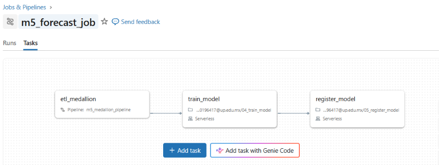
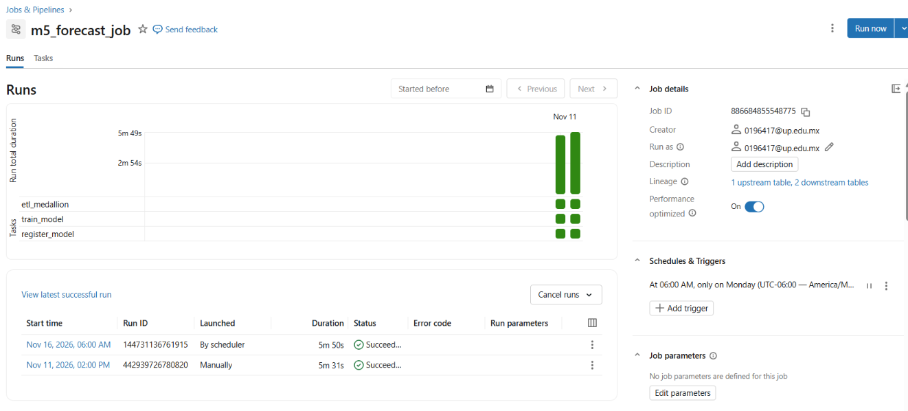
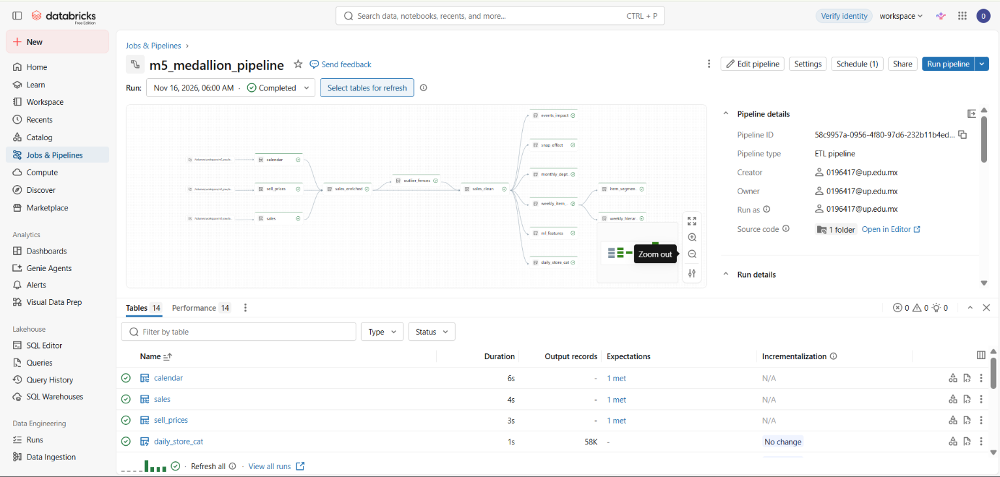
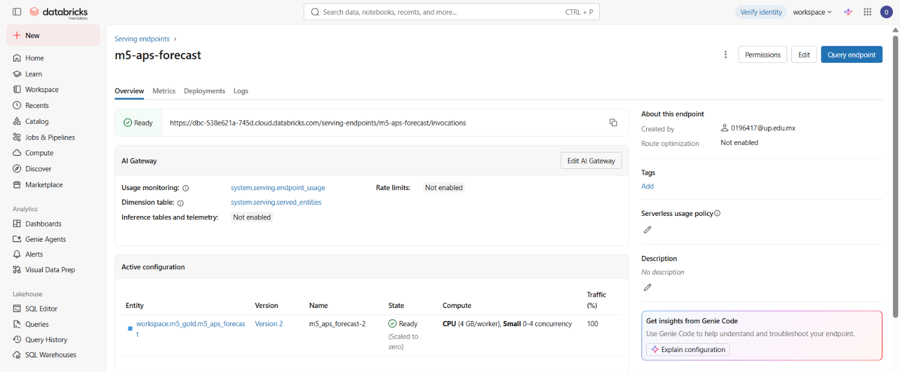
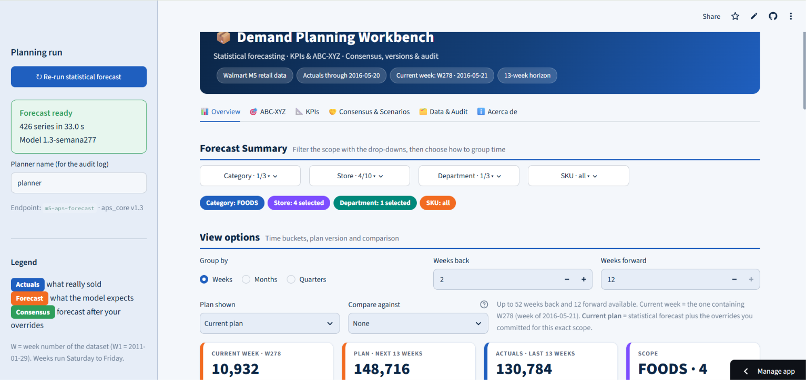
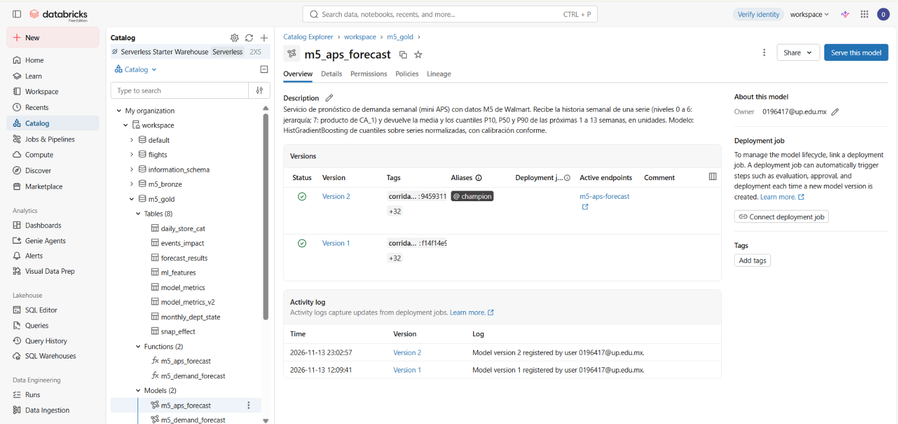

# M5 APS — Planeación de la demanda con Databricks

**Autor:** Mario Acevedo Amante · Universidad Panamericana
**Aplicación en línea:** https://m5-aps-demand-planning.streamlit.app/
**Repositorio:** https://github.com/marioacam1/m5-aps-demand-planning

> Plataforma de planeación de la demanda tipo APS (*Advanced Planning System*) construida de punta a punta sobre el dataset **M5 Forecasting de Walmart**: pipeline Medallion en Databricks, modelo de pronóstico probabilístico publicado como API y una aplicación web pública que lo consume.
>
> Nota: la primera carga de la aplicación puede tardar de 1 a 2 minutos porque el endpoint de Databricks escala a cero cuando está inactivo. Si la app muestra "This app has gone to sleep", basta pulsar el botón para despertarla.

---

## 1. Resumen y cómo se cubre la rúbrica

| Criterio | Dónde está en el proyecto |
|---|---|
| Limpieza y transformación de datos | Secciones 4 y 5: pipeline Lakeflow Bronze → Silver → Gold, con más de 59 millones de filas en Silver |
| Definición del problema y métricas | Sección 2: problema, métricas (WMAPE, sesgo, FVA, cobertura) y resultados de backtesting |
| Publicación del modelo | Sección 7: modelo en MLflow / Unity Catalog, endpoint de Model Serving, contrato de entrada y salida, validación y OpenAPI |
| Integración con la app de consulta | Sección 8: la app consume el endpoint, maneja timeouts, reintentos, errores y respuestas inválidas |

---

## 2. Problema y métricas

**Problema.** Una cadena de tiendas necesita saber cuánto se venderá en las próximas semanas para planear inventario, promociones y compras. Un pronóstico de un solo número por producto y día es difícil de usar: un planeador necesita el pronóstico **agregado** (por categoría, departamento, tienda), un **rango de incertidumbre**, saber **qué productos importan más y cuáles son más difíciles de predecir**, y poder **ajustar el pronóstico** con información comercial.

**Objetivo.** Pronosticar la demanda **semanal** a **13 semanas** para toda una jerarquía de series y exponerla en una herramienta de planeación.

**Métricas** (calculadas con *backtesting* móvil de 5 fechas de corte, sin ver el futuro):

| Métrica | Qué mide |
|---|---|
| **WMAPE** | Error total dividido entre las ventas totales: Σ\|real − pronóstico\| ÷ Σ real |
| **Forecast accuracy** | 1 − WMAPE |
| **Sesgo (bias)** | (Σ pronóstico − Σ real) ÷ Σ real. Positivo = sobrepronóstico |
| **FVA** (*forecast value added*) | Puntos de WMAPE que el modelo ahorra frente al mejor método simple (naive, naive estacional o promedio de 13 semanas) |
| **Cobertura del rango** | Porcentaje de semanas en que lo real cayó entre P10 y P90 (objetivo: 80 %) |
| **Pinball loss** | Error de los cuantiles |

### Resultados del backtesting

Resultados agregados de las 5 ventanas de backtesting (pestaña **KPIs** de la aplicación):

| Nivel | Accuracy | WMAPE | Sesgo | FVA vs mejor método simple | Cobertura del rango P10–P90 |
|---|---|---|---|---|---|
| Total | 96.8 % | 3.2 % | −0.0 % | +3.5 pp | 78.5 % |
| Category | 95.4 % | 4.6 % | −0.0 % | +3.1 pp | 80.1 % |
| Department | 94.0 % | 6.0 % | −1.3 % | +2.9 pp | 79.7 % |
| SKU | 56.7 % | 43.3 % | −1.5 % | +3.0 pp | 88.7 % |

**Cómo leerlos**
- A nivel agregado (Total, Category, Department) la precisión supera el 94 %, el sesgo es prácticamente nulo y el rango P10–P90 cubre cerca del 80 % prometido.
- A nivel **SKU** la precisión baja a 56.7 %. Es esperable: el **68 % de las filas diarias tienen cero ventas** (demanda intermitente), y el error porcentual de series pequeñas e irregulares es alto aunque el pronóstico sea razonable. Por eso la aplicación enfoca la planeación en los niveles agregados y usa el SKU para segmentación (ABC-XYZ) y consulta.
- En SKU el rango es **conservador**: cubre 88.7 % cuando el objetivo es 80 %, es decir, el intervalo es más ancho de lo necesario.
- El modelo mejora entre 2.9 y 3.5 puntos de WMAPE al mejor método simple (naive, naive estacional o promedio de 13 semanas), que en retail es una línea base exigente.

---

## 3. Datos

- **Fuente:** M5 Forecasting – Accuracy (Kaggle, Walmart). 3 estados, 10 tiendas, 3 categorías, 7 departamentos y 3,049 productos (30,490 series producto-tienda), con 1,941 días de ventas (2011-01-29 a 2016-06-19), calendario con eventos y precios semanales.
- **Escala:** la tabla de ventas en formato largo tiene **59,181,090 filas** (30,490 series × 1,941 días), muy por encima del mínimo de 4 millones del proyecto.
- **Carga:** los CSV se suben a un *Volume* de Unity Catalog (zona de aterrizaje) y de ahí los lee el pipeline.

---

## 4. Arquitectura

```
Kaggle M5 ─► Volume (landing)
              │
              ▼
   Pipeline Lakeflow  m5_medallion_pipeline
   Bronze ─► Silver ─► Gold (tablas diarias y semanales)
              │
              ▼
   Entrenamiento y backtesting (notebook 05b_aps_calibration, MLflow)
              │
              ▼
   Registro en Unity Catalog (06_register_aps_model) ─► Endpoint de Model Serving  m5-aps-forecast
              ▲                                                     ▲
   Job programado m5_forecast_job (lunes 6:00)                      │ HTTP POST + token
                                                                    │
                                    Aplicación Streamlit (Streamlit Community Cloud)
```

Los datos históricos y las tablas de precisión del backtesting se exportan desde Gold (notebook `08_export_app_data`) a la carpeta `data/` de este repositorio. **El modelo no está dentro de la aplicación:** cada pronóstico se obtiene con una petición HTTP al endpoint.

---

## 5. Pipeline Medallion (limpieza y transformación)

El pipeline `m5_medallion_pipeline` (Lakeflow) declara cada tabla en un archivo `.py`; Databricks calcula las dependencias y las ejecuta en orden. Los esquemas son `m5p_bronze`, `m5p_silver` y `m5p_gold`. Una corrida completa tarda unos 2–3 minutos.

| Archivo | Capa | Tablas que crea |
|---|---|---|
| `01_bronze.py` | Bronze | `calendar`, `sell_prices`, `sales`: los CSV del Volume tal como llegaron, con *expectations* (reglas de calidad) que se cumplen en cada corrida |
| `02_silver.py` | Silver | `sales_enriched` (ventas unidas con calendario y precios), `outlier_fences` (cotas de valores atípicos por serie) y `sales_clean` (ventas limpias, 59,181,090 filas) |
| `03_gold.py` | Gold | `events_impact`, `snap_effect`, `monthly_dept`, `daily_store_cat` y `ml_features` (análisis y tablas de características diarias) |
| `04_gold_aps.py` | Gold | `weekly_item_store`, `weekly_hierarchy` e `item_segmentation` (tablas semanales, jerarquía y segmentación ABC-XYZ) |

En total el pipeline gestiona **14 tablas**. La última ejecución programada (16 de noviembre, 6:00) terminó con éxito.

**Tablas Gold principales**

| Tabla | Filas | Contenido |
|---|---|---|
| `weekly_item_store` | 6,688,671 | Ventas semanales por producto y tienda |
| `weekly_hierarchy` | 34,348 | Ventas semanales de las 124 series de la jerarquía |
| `item_segmentation` | 30,490 | Segmento ABC-XYZ y clase de demanda por producto |

### Reglas de limpieza

La limpieza se hace en el notebook `02b_silver_clean` y produce la tabla `sales_clean` (**59,181,090 filas**, 24 columnas). Cada regla se verificó con una consulta de control:

| Regla | Qué se hizo | Resultado de la verificación |
|---|---|---|
| **Tipos y esquema** | Ventas pasadas de formato ancho a largo; `units_sold` entero, `date` como fecha, `sell_price` y `revenue` decimales; se añade `_silver_ts` para trazabilidad | 24 columnas con tipos explícitos |
| **Unión con calendario y precios** | Cada venta se une con el calendario (día, mes, año, eventos, SNAP del estado) y con el precio semanal (`wm_yr_wk`) | Sin pérdida de filas: 59,181,090 |
| **Variables derivadas** | `day_num`, `snap` (indicador SNAP del estado de la tienda), `is_available` y `revenue` = unidades × precio | — |
| **Duplicados** | Revisión por (`id`, `d`) y por (tienda, producto, fecha) | **0 duplicados** en ambas llaves |
| **Eventos** | Las columnas de evento están vacías el 91.86 % (`event_*_1`) y el 99.79 % (`event_*_2`) de los días porque la mayoría de los días no tiene evento; no son errores y se rellenan con una etiqueta explícita | `event_type_nulos` = **0** en la tabla final |
| **Precios faltantes** | Hay 12,299,413 filas (20.78 %) sin `sell_price`; todas corresponden a semanas **anteriores al primer precio del producto** (aún no estaba a la venta). No hay productos que nunca se vendieron ni huecos de precio después del primer precio. Esas filas **no se imputan**: se marcan con `is_available = false` | `precios_imputados` = 0; **0 ventas > 0** en filas sin precio (consistencia confirmada) |
| **Valores atípicos** | Se detectaron **131,202** valores atípicos (0.22 % de las filas) y se recortan para el entrenamiento; el valor real se conserva | Máximo real 763 → máximo recortado **511** |
| **Demanda intermitente** | No se elimina: el 68.0 % de las filas (40,241,819) tiene cero ventas y es información real. Con ventas > 0 los percentiles 50 / 90 / 99 / 99.9 son 2 / 7 / 28 / 72 unidades | Se tratan después con la clasificación de demanda (Smooth, Erratic, Intermittent, Lumpy) |

**Decisiones de diseño.** Los valores atípicos se recortan en lugar de borrarse para no romper la continuidad de la serie. Los precios faltantes antes del lanzamiento no se imputan, porque inventar un precio crearía ingresos que nunca existieron. Los ceros se conservan porque son parte de la demanda.

### Jerarquía de series (7 niveles + SKU)

| Nivel | Serie | Ejemplo |
|---|---|---|
| 0 | Total | `Total` |
| 1 | Estado | `CA` |
| 2 | Tienda | `CA_1` |
| 3 | Categoría | `FOODS` |
| 4 | Departamento | `FOODS_3` |
| 5 | Tienda × Categoría | `CA_1\|FOODS` |
| 6 | Tienda × Departamento | `CA_1\|FOODS_3` |
| 7 | SKU | `FOODS_3_090_CA_1` (302 SKUs de la tienda CA_1) |

### Segmentación ABC-XYZ

- **ABC** por Pareto de ingreso: A = primer 80 % acumulado, B = siguiente 15 %, C = el resto.
- **XYZ** por coeficiente de variación de las ventas semanales: X < 0.25, Y entre 0.25 y 0.50, Z > 0.50.
- Además, la clase de demanda (Smooth, Erratic, Intermittent, Lumpy) usa los umbrales de Syntetos-Boylan (ADI 1.32, CV² 0.49).

---

## 6. Modelo

- **Horizonte y frecuencia:** demanda semanal, 13 semanas hacia adelante.
- **Pronóstico probabilístico:** modelos **HistGradientBoosting** de cuantiles, entrenados sobre series normalizadas, que predicen la media y los cuantiles **P10 / P50 / P90**. P10 es el "Low case" y P90 el "High case"; el rango entre ambos debe contener la demanda cerca del 80 % de las semanas.
- **Modelos separados** para la jerarquía y para los SKUs, más un modelo de la media (versión `aps_core` 1.3).
- **Calibración conforme:** el rango sin calibrar cubría menos de lo prometido; se ajusta con datos de calibración para acercar la cobertura real al 80 %.
- **Backtesting:** 5 ventanas móviles de fechas de corte; en cada una se pronostica y se compara con lo ocurrido. Las tablas resultantes (`accuracy_*.csv`, `backtest_hierarchy.csv.gz`) alimentan la pestaña KPIs.
- **Coherencia jerárquica:** la app concilia las series de la jerarquía con **MinT** para que las partes sumen el total.
- **Seguimiento:** parámetros, métricas y artefactos en MLflow.

---

## 7. Publicación del modelo

- **Registro:** modelo `workspace.m5_gold.m5_aps_forecast` en Unity Catalog (versión 2, alias `champion`).
- **Endpoint:** `m5-aps-forecast` en Databricks Model Serving (CPU de 4 GB, tamaño *Small* con 0–4 de concurrencia, escala a cero cuando está inactivo). Ruta: `POST {host}/serving-endpoints/m5-aps-forecast/invocations`.

**Entrada**
```json
{"dataframe_records": [
  {"series_id": "CA_1|FOODS", "level": 5, "last_week": 277, "horizon": 13,
   "history": [1234.0, 1301.0, "... entre 26 y 300 valores semanales ..."]}
]}
```

**Salida (por serie y semana)**
```json
{"predictions": [
  {"series_id": "CA_1|FOODS", "status": "ok", "target_week": 278, "week_start": "2016-05-21",
   "mean": 1500.2, "p10": 1320.4, "p50": 1495.8, "p90": 1690.1, "model_version": "1.3-semana277"}
]}
```

**Validación de entradas** (rechaza con HTTP 400 y un mensaje claro):
- `level` entre 0 y 7;
- `horizon` entre 1 y 13;
- `history` con entre 26 y 300 valores, todos numéricos y no negativos;
- como máximo 200 series por petición.

**Documentación de la API:** el endpoint expone su esquema OpenAPI (descargable desde la pantalla del endpoint en Databricks: *Serving → m5-aps-forecast → Use → View API / OpenAPI*).

Las capturas del endpoint, el pipeline y el Job están en la sección 12.

### Job programado

El Job `m5_forecast_job` orquesta el flujo con tres tareas encadenadas: `etl_medallion` (el pipeline Medallion), `train_model` (notebook `04_train_model`) y `register_model` (notebook `05_register_model`). Está programado **todos los lunes a las 6:00 (America/Mexico_City)**; la ejecución programada del 16 de noviembre terminó con éxito en 5 min 50 s.

El entrenamiento, la calibración y el registro del modelo semanal del APS (notebooks `05b_aps_calibration` y `06_register_aps_model`) y la exportación de datos de la app (`08_export_app_data`) se ejecutan con los notebooks cuando se quiere reentrenar; el endpoint sirve la versión registrada que se fija de forma explícita.

---

## 8. Aplicación web (capa de resultados)

**Enlace:** https://m5-aps-demand-planning.streamlit.app/

Construida con Streamlit y desplegada en Streamlit Community Cloud. Al abrirse, llama automáticamente al endpoint con las 124 series de la jerarquía y los 302 SKUs, y concilia el resultado.

| Pestaña | Qué ofrece |
|---|---|
| **Overview** | *Forecast Summary* con filtros por checkboxes (Category, Store, Department, SKU), vista por semana, mes o trimestre, semana actual marcada, comparación contra el año anterior y contra una versión congelada, gráfica de línea y *drill-down* |
| **ABC-XYZ** | Resumen de los 9 segmentos, matriz 9-box interactiva, método estadístico recomendado y *drill-down* por Category, Department o SKU; ventana configurable (3, 6 o 12 meses) |
| **KPIs** | Accuracy, sesgo, FVA y cobertura del backtesting; accuracy por nivel y por horizonte; *Inventory health* (días de cobertura y alertas de quiebre con inventario importado) |
| **Consensus & Scenarios** | Overrides por capas (Sales override → Marketing event → Final consensus) en unidades, bloqueo de semanas pasadas, código de motivo y comentario obligatorios, reversión, distribución top-down y escenarios exportables a Excel |
| **Data & Audit** | Importación y validación de CSV/Excel, log de auditoría y versiones congeladas |
| **Acerca de** | Arquitectura, metodología y limitaciones (en español) |

### Integración con el endpoint

| Aspecto | Implementación |
|---|---|
| Timeouts | 20 s para conectar y 90 s para leer la respuesta |
| Reintentos | Hasta 4 intentos con esperas de 3, 6 y 12 s ante timeout, error de conexión, 408/425/429 y 5xx |
| Sin reintento | Errores 400, 401, 403 y 404, que se muestran con un mensaje claro |
| Respuestas inválidas | Cada respuesta se valida: campos obligatorios, longitudes, números finitos y no negativos, cuantiles ordenados y fechas |
| Lotes | Máximo 200 series por petición; la app parte las consultas grandes |
| Antirrebote | Pausa de 2 s entre ejecuciones manuales |
| Seguridad | El token de acceso vive solo en los *Secrets* de Streamlit; no está en el código ni en este repositorio |

---

## 9. Cómo ejecutarlo en local

```bash
git clone https://github.com/marioacam1/m5-aps-demand-planning.git
cd m5-aps-demand-planning
pip install -r requirements.txt
```

Crea el archivo `.streamlit/secrets.toml` (está en `.gitignore`):

```toml
DATABRICKS_HOST = "https://<tu-workspace>.cloud.databricks.com"
DATABRICKS_TOKEN = "<tu-token>"
ENDPOINT_NAME = "m5-aps-forecast"
```

```bash
streamlit run app.py
```

Pruebas automáticas (no necesitan Databricks):

```bash
python tests/test_logic.py
python tests/test_scope.py
python tests/test_v4.py
```

---

## 10. Estructura del repositorio

```
app.py              aplicación Streamlit (pestañas)
client.py           cliente del endpoint: timeouts, reintentos y validación de respuestas
forecast_utils.py   construcción de peticiones, reconciliación y coherencia
scope.py            filtros → series, agregación semanal y por periodos
scenarios.py        overrides por capas y escenarios
abcxyz.py           clasificación ABC-XYZ y métodos recomendados
governance.py       auditoría, versiones y validación de importaciones
charts.py, ui.py    gráficas y componentes visuales
aps_core.py         lógica del modelo compartida (jerarquía, reconciliación)
data_access.py      lectura de la carpeta data/
excel_export.py     exportación a Excel
data/               historia y tablas de precisión exportadas desde Gold
tests/              pruebas automáticas
.streamlit/         tema visual (el archivo secrets.toml NO se versiona)
```

---

## 11. Limitaciones

- La app **no reentrena**: solo consume el modelo publicado. El reentrenamiento ocurre en Databricks.
- Los SKUs de la aplicación son una **muestra de 302 productos de la tienda CA_1**; el modelo atiende toda la jerarquía.
- El Low case de un SKU individual suele ser 0, porque muchos SKUs venden solo algunas semanas.
- Al combinar varias series, la suma de las medias es exacta, pero el rango Low–High es **aproximado** (supone independencia entre series).
- Las métricas de KPIs vienen del **backtesting**, no de operación en vivo.
- El **FVA de los overrides** (error estadístico − error del consenso) aún no puede medirse, porque no existen ventas reales posteriores a un override confirmado.
- El inventario proviene del archivo importado; si no hay archivo, la app ofrece una demo claramente marcada como ilustrativa.
- Los overrides, versiones y el log de auditoría viven en la sesión del navegador; en Streamlit Community Cloud no son persistentes.
- Los precios por SKU son promedios de las últimas 52 semanas.

---

## 12. Evidencias

**Job programado: tareas y ejecuciones**




**Pipeline Medallion (14 tablas, ejecución completada)**



**Endpoint publicado (estado Ready)**



**Aplicación en línea consumiendo el endpoint** (426 series en 33 s, modelo `1.3-semana277`)



**Modelo registrado en Unity Catalog** (versión 2 con alias `champion`, servida por el endpoint `m5-aps-forecast`; la versión 1 se conserva como historial)



---

*Datos: M5 Forecasting – Accuracy, Walmart (Kaggle). Proyecto académico, Universidad Panamericana.*
